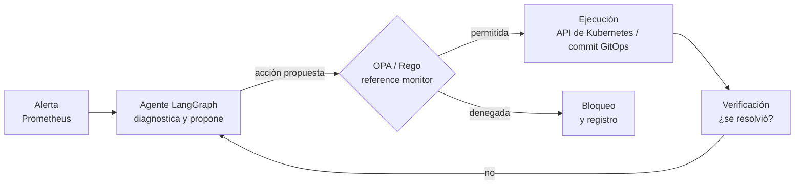

# autokub-aiops

**AIOps agéntico para Kubernetes: remediación autónoma acotada con política de seguridad impuesta en tiempo de ejecución.**

Un agente basado en LLM detecta, diagnostica y remedia incidentes en un clúster de Kubernetes. Ninguna acción se ejecuta sin la autorización de un motor de políticas determinista (OPA): la seguridad se apoya en el código, no en el prompt.

---

## El problema

Ante un incidente en producción, la persona de guardia recibe una alerta, revisa métricas, logs y trazas, localiza la causa y aplica una corrección conocida: reiniciar, revertir un despliegue, ajustar recursos. Gran parte de ese trabajo es repetitivo y está documentado en runbooks.

Los LLM ya pueden razonar sobre ese diagnóstico, pero darles permisos de escritura sobre un clúster es arriesgado: pueden equivocarse, alucinar o ser manipulados mediante *prompt injection* (por ejemplo, con contenido malicioso en los logs que analizan).

## Enfoque

Se separa **quién decide** de **quién autoriza**:



- **El agente nunca actúa directamente.** Solo propone acciones estructuradas.
- **OPA decide de forma determinista** qué acción, sobre qué recurso y con qué frecuencia está permitida. Las políticas son código Rego con tests.
- **Resistente a prompt injection:** aunque el modelo sea manipulado, una acción fuera de política se bloquea.
- **Verificación posterior:** cada remediación se comprueba contra las métricas antes de darla por buena.
- **Human-on-the-loop:** las personas definen las políticas y supervisan; no ejecutan comandos.

## Catálogo de incidentes

El agente opera sobre un catálogo cerrado, con prioridad para los casos en que síntoma y causa están en servicios distintos:

| # | Incidente | Remediación esperada |
|---|-----------|----------------------|
| 1 | Pod en `CrashLoopBackOff` | Diagnóstico y reinicio o rollback |
| 2 | Contenedor `OOMKilled` | Ajuste de límites o escalado |
| 3 | Despliegue que degrada la latencia | Rollback a la versión anterior |
| 4 | Drift de configuración | Detección y corrección |

Cada incidente tiene un script que lo provoca (`scenarios/`) y un runbook de resolución manual (`runbooks/`), que sirve como línea base para medir al agente.

## Producto objetivo

El sistema opera sobre un fork de la [OpenTelemetry Demo](https://github.com/open-telemetry/opentelemetry-demo) (Astronomy Shop): una tienda online de microservicios en varios lenguajes, instrumentada con OpenTelemetry, con fallos activables mediante feature flags y generador de carga incluido.

- Fork con el código de los servicios y su pipeline de CI: [MarcosPerezCantero/opentelemetry-demo](https://github.com/MarcosPerezCantero/opentelemetry-demo)
- Este repositorio: infraestructura, manifiestos GitOps, agente, políticas, escenarios y runbooks.

## Stack

| Área | Tecnologías |
|------|-------------|
| Clúster | k3d (k3s en Docker), Helm |
| Observabilidad | kube-prometheus-stack, Loki, OpenTelemetry Collector, Jaeger |
| CI/CD | GitHub Actions (build selectivo por servicio, Trivy, SBOM), GHCR |
| GitOps | Argo CD |
| Agente | LangGraph, LiteLLM, Langfuse |
| Políticas | OPA + Rego |

## Estructura del repositorio

```
autokub-aiops/
├── infra/       # bootstrap del entorno, configuración de k3d, values de Helm
├── deploy/      # manifiestos propios y values del chart (fuente de Argo CD)
├── agent/       # agente LangGraph
├── policies/    # políticas Rego y sus tests
├── scenarios/   # scripts que provocan cada incidente
├── runbooks/    # resolución manual de cada incidente
└── docs/adr/    # registros de decisiones de arquitectura
```

## Puesta en marcha

Requisitos: Ubuntu 24.04 (nativo o en WSL2), x86_64. El laboratorio completo necesita unos 16 GB de RAM.

```bash
git clone https://github.com/MarcosPerezCantero/autokub-aiops.git
cd autokub-aiops

# Docker Engine (repositorio oficial, clave GPG verificada)
sudo ./infra/bootstrap/install-docker.sh

# kubectl, k3d, Helm, GitHub CLI y make (versiones fijadas, firmas y checksums verificados)
sudo ./infra/bootstrap/install-k8s-tools.sh
```

Los scripts son idempotentes: pueden ejecutarse varias veces y solo cambian lo que falta o está desactualizado. El clúster y el resto del laboratorio se añadirán como objetivos de `make`.

## Hoja de ruta

- [x] Entorno reproducible del laboratorio (Docker Engine, kubectl, k3d, Helm)
- [ ] Despliegue del producto en Kubernetes (manifiestos propios + chart oficial)
- [ ] Observabilidad: dashboards y alertas para los cuatro incidentes
- [ ] Escenarios y runbooks manuales; MTTR de referencia
- [ ] CI/CD en el fork y GitOps con Argo CD
- [ ] Agente: diagnóstico de solo lectura → autorización OPA → ejecución y verificación
- [ ] Evaluación: agente frente a resolución manual (acierto, MTTR, acciones bloqueadas, coste) y pruebas de prompt injection

## Decisiones de arquitectura

| ADR | Decisión |
|-----|----------|
| [0001](docs/adr/0001-producto-objetivo.md) | Producto objetivo: fork de la OpenTelemetry Demo |
| [0002](docs/adr/0002-entorno-laboratorio.md) | Entorno del laboratorio: Ubuntu en WSL2 con Docker Engine |
