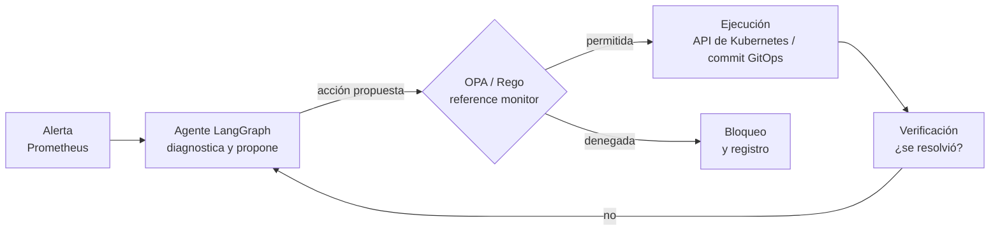

# autokub-aiops

**AIOps agéntico para Kubernetes: remediación autónoma acotada con política de seguridad impuesta en tiempo de ejecución.**

Un agente basado en LLM detecta, diagnostica y remedia incidentes en un clúster de Kubernetes. Ninguna acción se ejecuta sin la autorización de un motor de políticas determinista (OPA): la seguridad se apoya en el código, no en el prompt.

---

## El problema

Ante un incidente en producción, la persona de guardia recibe una alerta, revisa métricas, logs y trazas, localiza la causa y aplica una corrección conocida: reiniciar, revertir un despliegue, ajustar recursos. Gran parte de ese trabajo es repetitivo y está documentado en runbooks.

Los LLM ya pueden razonar sobre ese diagnóstico, pero darles permisos de escritura sobre un clúster es arriesgado: pueden equivocarse, alucinar o ser manipulados mediante *prompt injection* (por ejemplo, con contenido malicioso en los logs que analizan).

## Enfoque

Se separa **quién decide** de **quién autoriza**:



- **El agente nunca actúa directamente.** Solo propone acciones estructuradas.
- **OPA decide de forma determinista** qué acción, sobre qué recurso y con qué frecuencia está permitida. Las políticas son código Rego con tests.
- **Resistente a prompt injection:** aunque el modelo sea manipulado, una acción fuera de política se bloquea.
- **Verificación posterior:** cada remediación se comprueba contra las métricas antes de darla por buena.
- **Human-on-the-loop:** las personas definen las políticas y supervisan; no ejecutan comandos.

## Pruébalo en tu máquina

Requisitos: Docker, [k3d](https://k3d.io), kubectl y helm, y unos 6 GB de RAM libres.

```bash
git clone https://github.com/MarcosPerezCantero/autokub-aiops.git && cd autokub-aiops
make try            # clúster k3d + tienda de demostración + autokub en modo propuesta (unos 4 minutos)
make try-incident   # provoca un CrashLoopBackOff en product-catalog
make try-events     # qué detecta, qué propone y qué decide OPA, en directo
make try-execute    # pasa a modo ejecución: autokub aplica el rollback que OPA autoriza
make down           # borra el clúster
```

Sin clave de API funciona con un proponedor de reglas fijas. Para usar el agente LLM, crea `.local/anthropic.env` con `ANTHROPIC_API_KEY=...` antes de `make try`.

## Instálalo en tu clúster

autokub se instala con Helm y empieza en **modo propuesta**: detecta, propone y consulta a OPA, pero no modifica nada ni tiene permisos para hacerlo.

```bash
kubectl create namespace autokub-system
kubectl -n autokub-system create secret generic autokub-llm --from-literal=api-key=<clave>

cat > autokub.yaml <<'YAML'
namespaces:
  tienda:                          # tu namespace
    targets: [api, web, worker]    # Deployments sobre los que puede actuar
YAML

helm install autokub oci://ghcr.io/marcosperezcantero/charts/autokub --version 0.1.0 \
  -n autokub-system -f autokub.yaml
```

Cuando sus propuestas te convenzan, `--set mode=execute` le da permiso para aplicar, solo sobre esos Deployments. Detalle de componentes, permisos y configuración en [docs/despliegue.md](docs/despliegue.md).

## Catálogo de incidentes

El agente opera sobre un catálogo cerrado, con prioridad para los casos en que síntoma y causa están en servicios distintos:

| # | Incidente | Remediación esperada |
|---|-----------|----------------------|
| 1 | Pod en `CrashLoopBackOff` | Diagnóstico y rollback |
| 2 | Fallo con síntoma y causa en servicios distintos | Localizar el servicio causante y hacer rollback |
| 3 | Contenedor `OOMKilled` | Ajuste acotado de límites y aviso a una persona |
| 4 | Despliegue que degrada la latencia | Rollback a la versión anterior |
| 5 | Drift de configuración (opcional) | Detección y corrección |

Cada incidente tiene un script que lo provoca (`scenarios/`) y un runbook de resolución manual (`runbooks/`), que sirve como línea base para medir al agente.

Las acciones permitidas al agente también forman una lista cerrada: ver [ADR 0004](docs/adr/0004-alcance-del-agente.md). La [arquitectura](docs/arquitectura.md) detalla los componentes y la frontera de seguridad, el [despliegue](docs/despliegue.md) cómo funcionará instalado en cualquier clúster, y el [plan de evaluación](docs/evaluacion.md) cómo se mide el resultado.

## Producto objetivo

El sistema opera sobre un fork de la [OpenTelemetry Demo](https://github.com/open-telemetry/opentelemetry-demo) (Astronomy Shop): una tienda online de microservicios en varios lenguajes, instrumentada con OpenTelemetry, con fallos activables mediante feature flags y generador de carga incluido.

- Fork con el código de los servicios y su pipeline de CI: [MarcosPerezCantero/opentelemetry-demo](https://github.com/MarcosPerezCantero/opentelemetry-demo)
- Este repositorio: infraestructura, manifiestos GitOps, agente, políticas, escenarios y runbooks.

## Stack

| Área | Tecnologías |
|------|-------------|
| Clúster | k3d (k3s en Docker), Helm |
| Observabilidad | kube-prometheus-stack, Loki, OpenTelemetry Collector, Jaeger |
| CI/CD | GitHub Actions (build selectivo por servicio, Trivy, SBOM), GHCR |
| GitOps | Argo CD |
| Agente | LangGraph; API de Anthropic o compatible con OpenAI (LiteLLM, Ollama…); Langfuse |
| Políticas | OPA + Rego |

## Estructura del repositorio

```
autokub-aiops/
├── config/      # configuración: namespaces, servicios permitidos y límites
├── infra/       # bootstrap del entorno, configuración de k3d, generación del RBAC
├── deploy/      # manifiestos propios y values del chart (fuente de Argo CD)
├── agent/       # agente LangGraph
├── policies/    # políticas Rego y sus tests
├── executor/    # ejecutor: único componente con permisos de escritura
├── viewer/      # vista web del flujo, de solo lectura
├── scenarios/   # scripts que provocan cada incidente
├── runbooks/    # resolución manual de cada incidente
└── docs/adr/    # registros de decisiones de arquitectura
```

## Puesta en marcha

Requisitos: Ubuntu 24.04 (nativo o en WSL2), x86_64. El laboratorio completo necesita unos 16 GB de RAM.

```bash
git clone https://github.com/MarcosPerezCantero/autokub-aiops.git
cd autokub-aiops

# Docker Engine (repositorio oficial, clave GPG verificada)
sudo ./infra/bootstrap/install-docker.sh

# kubectl, k3d, Helm, k9s, OPA, GitHub CLI y make (versiones fijadas, firmas y checksums verificados)
sudo ./infra/bootstrap/install-k8s-tools.sh
```

Los scripts son idempotentes: pueden ejecutarse varias veces y solo cambian lo que falta o está desactualizado.

En macOS (Apple Silicon), las herramientas se instalan con Homebrew y Docker lo aporta OrbStack o Docker Desktop:

```bash
brew install kubectl k3d helm k9s opa ruff python@3.12
make venv PYTHON=python3.12
```

```bash
make up       # crea el clúster k3d (1 nodo de control + 2 de trabajo), definido en infra/k3d/cluster.yaml
make status   # estado del clúster
make stop     # para el clúster sin borrarlo (make up lo reanuda)
make demo     # despliega la tienda (chart oficial + deploy/otel-demo/values.yaml) en http://localhost:8080
make down     # destruye el clúster
make test           # todos los tests, sin clúster (políticas, ejecutor, agente y vista)
make lint           # comprobaciones de Rego y Python
make policies-test  # comprueba las políticas Rego y ejecuta sus tests
make venv           # crea el entorno de Python del agente
make agent-test     # ejecuta los tests del ejecutor y del agente
make auth           # crea las cuentas del lector y del ejecutor (tokens de 24 h)
make prototype      # arranca la cadena con reglas fijas
make prototype-llm  # arranca la cadena con el agente LLM (requiere .local/anthropic.env)
                    # vista del flujo en http://localhost:8091
```

## Hoja de ruta

- [x] Entorno reproducible del laboratorio (Docker Engine, kubectl, k3d, Helm)
- [x] Despliegue del producto en Kubernetes con el chart oficial
- [x] Prototipo vertical: un incidente de extremo a extremo (detección → agente → OPA → ejecución → verificación)
- [ ] **Versión 0.1 instalable**: CrashLoopBackOff en cualquier clúster ([ADR 0006](docs/adr/0006-producto-instalable.md))
  - [x] Configuración en un fichero (namespaces, servicios permitidos, límites), sin datos de la demo en el código
  - [x] Modo solo propuesta por defecto: muestra la acción y la decisión de OPA sin ejecutarla
  - [x] Modelo intercambiable: API de Anthropic o cualquier API compatible con OpenAI (LiteLLM, Ollama, vLLM…)
  - [x] Chart de Helm e imágenes; agente, ejecutor y OPA como pods
  - [x] Demo de prueba en un comando (k3d, tienda, sistema e incidente)
  - [x] Licencia MIT
  - [ ] Release 0.1 con changelog
- [ ] Observabilidad: dashboards y alertas para los incidentes del catálogo
- [ ] Escenarios y runbooks manuales; MTTR de referencia
- [ ] Manifiestos propios, CI/CD en el fork y GitOps con Argo CD, con remediación compatible con GitOps
- [ ] Agente: ampliación al resto del catálogo
- [ ] Evaluación: agente frente a reglas fijas y resolución manual (acierto, MTTR, acciones bloqueadas, coste) y pruebas de prompt injection

## Decisiones de arquitectura

| ADR | Decisión |
|-----|----------|
| [0001](docs/adr/0001-producto-objetivo.md) | Producto objetivo: fork de la OpenTelemetry Demo |
| [0002](docs/adr/0002-entorno-laboratorio.md) | Entorno del laboratorio: Ubuntu en WSL2 con Docker Engine |
| [0004](docs/adr/0004-alcance-del-agente.md) | Alcance del agente: incidentes y acciones permitidas |
| [0005](docs/adr/0005-prototipo-vertical.md) | Prototipo vertical antes de completar la plataforma |
| [0006](docs/adr/0006-producto-instalable.md) | Versión instalable antes de ampliar el catálogo |
| [0007](docs/adr/0007-interfaz-con-el-modelo.md) | Interfaz con el modelo: API nativa o compatible con OpenAI |

## Licencia

[MIT](LICENSE)
