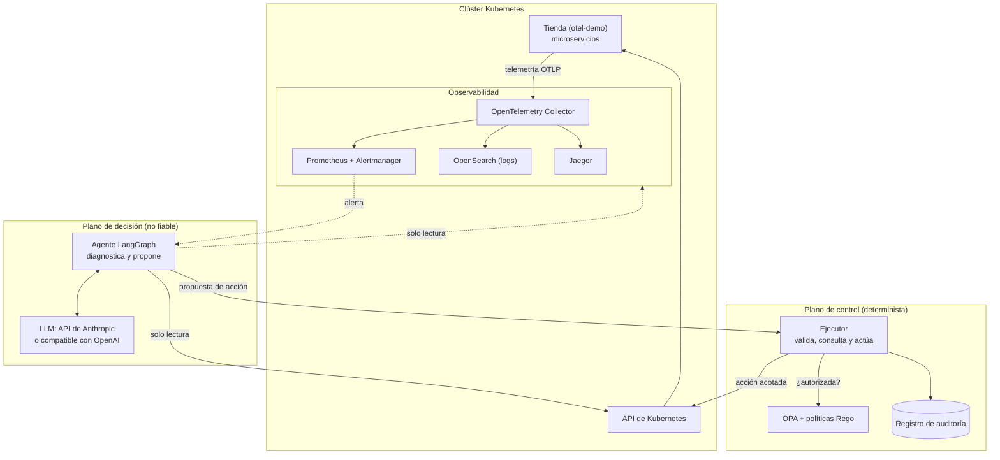
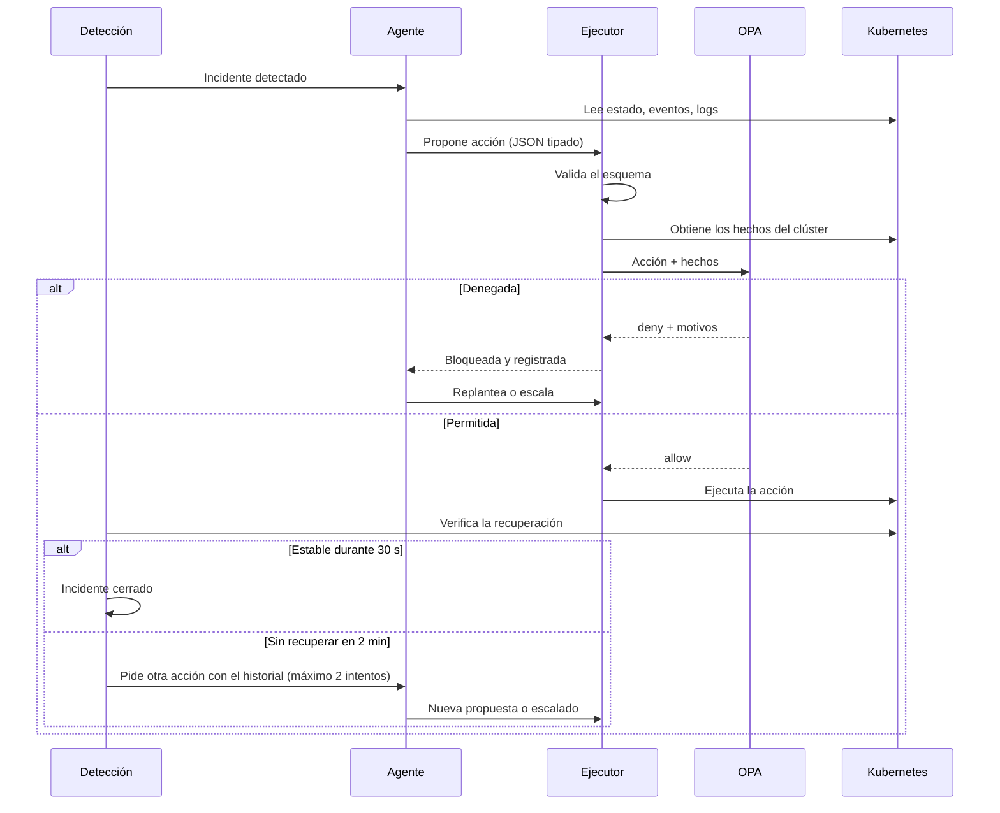
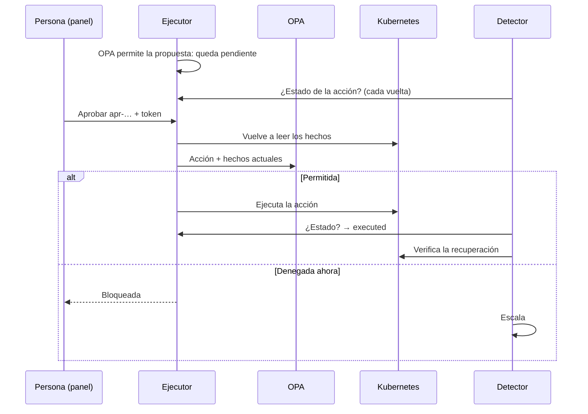

# Arquitectura

Este documento describe el sistema tal como funciona hoy en el laboratorio, donde `config/lab.json` activa el modo `execute`. Por defecto el sistema solo propone (ver [despliegue.md](despliegue.md#modos-de-funcionamiento)). Cómo se instala y funciona en cualquier clúster: [despliegue.md](despliegue.md).

## Componentes



Las líneas discontinuas son conexiones previstas que aún no existen: hoy el detector lee el estado de los pods en la API de Kubernetes, y el agente solo consulta esa API (estado, eventos, logs y revisiones). La detección por alertas y la lectura de métricas, logs y trazas llegan con el resto del catálogo.

La separación clave es entre dos planos:

- **Plano de decisión.** Se considera no fiable, porque su entrada incluye contenido que un atacante puede influir (logs, por ejemplo) y su razonamiento puede fallar. Solo tiene credenciales de lectura.
- **Plano de control.** Es código determinista, sin LLM. Es el único con permisos de escritura.

Esto convierte a OPA en un verdadero *reference monitor*: no se apoya en que el agente decida consultarlo, porque el agente no dispone de credenciales para actuar por otra vía.

## Flujo de un incidente



La verificación es de solo lectura, por lo que la hace el detector. Un despliegue se considera sano si todas sus réplicas son de la revisión actual, todos sus contenedores están listos y los reinicios no aumentan durante 30 segundos. Esta ventana es necesaria porque los servicios no tienen readiness probes y `kubectl get deployment` puede mostrar 1/1 con una revisión rota mientras sigue activa la anterior.

## Frontera de seguridad

| Mecanismo | Qué garantiza |
|-----------|---------------|
| Credenciales separadas | El agente solo lee; el ejecutor es el único que escribe |
| RBAC del ejecutor | Limitado a los namespaces configurados y a sus Deployments permitidos, sin Secrets; se genera desde la misma configuración que lee OPA |
| Operaciones fijas | El ejecutor implementa cada acción del catálogo; nunca ejecuta texto generado por el modelo |
| Validación de esquema | Una salida malformada del modelo se rechaza antes de llegar a OPA |
| Hechos obtenidos por el ejecutor | La política evalúa datos leídos del clúster, no lo que el modelo afirma |
| Denegación por defecto | Si OPA no responde o no hay regla, la acción no se ejecuta (*fail-closed*) |
| Límite de frecuencia | Corta los bucles de remediación. El historial vive en el Deployment y sobrevive a reinicios del ejecutor |
| Registro de auditoría | Cada propuesta y decisión queda registrada, también las bloqueadas |
| Aprobación sin atajos | En modo `approve` solo se aprueba lo que OPA ya permitió, y al aprobarlo OPA vuelve a decidir con los hechos de ese momento. El agente no tiene el token de aprobación |

RBAC y OPA son capas complementarias: RBAC no distingue, por ejemplo, un cambio de memoria razonable de uno excesivo; OPA sí. Y si la política tuviera un error, RBAC sigue acotando el daño posible.

### Alternativa considerada: control de admisión

OPA Gatekeeper impone políticas en la propia API de Kubernetes, por lo que no depende de ningún componente propio. Se mantiene el ejecutor porque aplica con más facilidad límites de frecuencia y condiciones ligadas al incidente, y porque cada acción sigue siendo una operación fija. El control de admisión queda como posible capa adicional, no como sustituto.

## Contrato con OPA

Entrada que el ejecutor envía a la política:

```json
{
  "action": {
    "type": "rollout_undo",
    "namespace": "otel-demo",
    "target": "product-catalog",
    "params": {}
  },
  "facts": {
    "deployment_exists": true,
    "previous_revision": 4,
    "unhealthy_pods": 1,
    "actions_last_hour_on_target": 0
  }
}
```

`action` procede de la propuesta del agente; `facts` lo completa el ejecutor. `unhealthy_pods` cuenta los pods de la revisión actual que no están listos y acumulan reinicios: no depende del texto de estado, que alterna entre `Error` y `CrashLoopBackOff`. `set_memory_limit` usa además `oom_killed_recently`, `current_memory_limit_bytes` y `target_container`: el contenedor sobre el que actuar, que es el único del pod o el que falla, sin suponer que se llame como el Deployment.

Respuesta:

```json
{ "allow": false, "deny_reasons": ["target no permitido"] }
```

La política está en `policies/remediation.rego` y se consulta en `POST /v1/data/autokub/remediation/decision`. No contiene listas fijas: los namespaces, los servicios permitidos y los límites los recibe como datos en `data.autokub.config` (en el laboratorio, `config/lab.json`). Sin esos datos, deniega toda acción que modifique el clúster. `revert_drift` aún no está permitida, a la espera de ADR 0003.

## Trazabilidad del flujo

Cada componente emite un evento por cada paso del incidente, con un formato común:

```json
{
  "incident_id": "inc-0042",
  "timestamp": "2026-01-01T12:00:00Z",
  "component": "opa",
  "event": "action_denied",
  "summary": "target no permitido",
  "data": { "action": "rollout_undo", "target": "flagd" }
}
```

Los eventos son `incident_detected`, `agent_thinking`, `agent_text`, `agent_tool_call`, `agent_tool_result`, `agent_diagnosis`, `agent_failed`, `action_proposed`, `action_rejected`, `action_allowed`, `action_denied`, `action_executed`, `action_would_execute` (modo propuesta), `action_pending_approval`, `action_approved`, `action_rejected_by_human` y `approval_expired` (modo aprobación), `action_failed`, `history_rewrite_failed`, `verification_passed`, `verification_failed`, `incident_escalated` e `incident_closed`. El chat añade `chat_question`, `chat_tool_call`, `chat_answer` y `chat_failed`. El `incident_id` permite reconstruir el recorrido completo de cada incidente. Las marcas de tiempo llevan milisegundos para ordenar eventos de varios pods.

Sobre estos eventos se apoyan dos usos:

- **Auditoría y evaluación:** de ellos salen los tiempos y las acciones bloqueadas.
- **Panel de operación** ([ADR 0009](adr/0009-panel-de-operacion.md)): una página web que muestra en directo los incidentes, por qué paso va cada uno, qué ha leído y razonado el agente y qué hechos evaluó OPA. El razonamiento es el resumen que devuelve la API, no el proceso interno en bruto.

Langfuse complementa el panel con el detalle interno del agente: prompts, respuestas, herramientas y coste. El panel cubre lo que Langfuse no ve: el recorrido por OPA, el ejecutor y Kubernetes.

El panel **no tiene permisos sobre la aplicación** y el sistema funciona igual sin él, salvo el modo `approve`, que lo necesita para decidir. Solo puede hacer dos cosas, y ninguna abre un camino alternativo al ejecutor:

- **Aprobar o rechazar** una acción pendiente. Envía al ejecutor el identificador y la decisión, nunca una acción, con un token que el agente no tiene. El ejecutor vuelve a leer los hechos y a consultar a OPA antes de actuar: una persona no puede saltarse la política desde el panel.
- **Preguntar al agente.** El chat usa las herramientas de lectura del diagnóstico, sin `propose_action`: aunque una pregunta o un log lo manipulen, no tiene forma de actuar.



Los eventos pueden contener texto que procede de logs, por lo que el panel lo trata como contenido no fiable y lo muestra escapado, con una política de contenido que impide cargar nada externo.

## Prompt injection indirecta

Los logs y eventos son datos que pueden contener instrucciones maliciosas. Se asume que algún intento puede engañar al modelo, y la defensa no depende de evitarlo: aunque el agente proponga una acción dañina, tiene que superar la validación, OPA y RBAC. Marcar el contenido no fiable en el prompt reduce la probabilidad de engaño, pero no se cuenta como control de seguridad.

Esta defensa limita **qué** puede hacerse, no si la decisión es acertada: un modelo manipulado aún podría proponer una acción permitida pero innecesaria, como reiniciar un servicio sano. La exigencia de hechos que justifiquen la acción y el límite de frecuencia reducen ese margen, y la evaluación debe medirlo.
