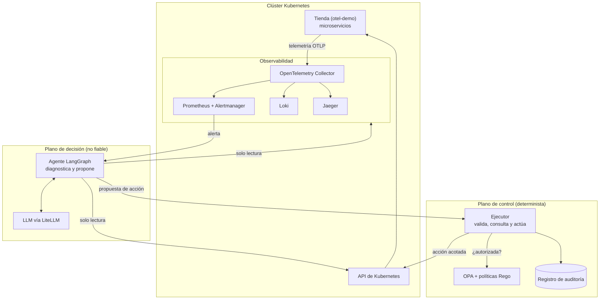
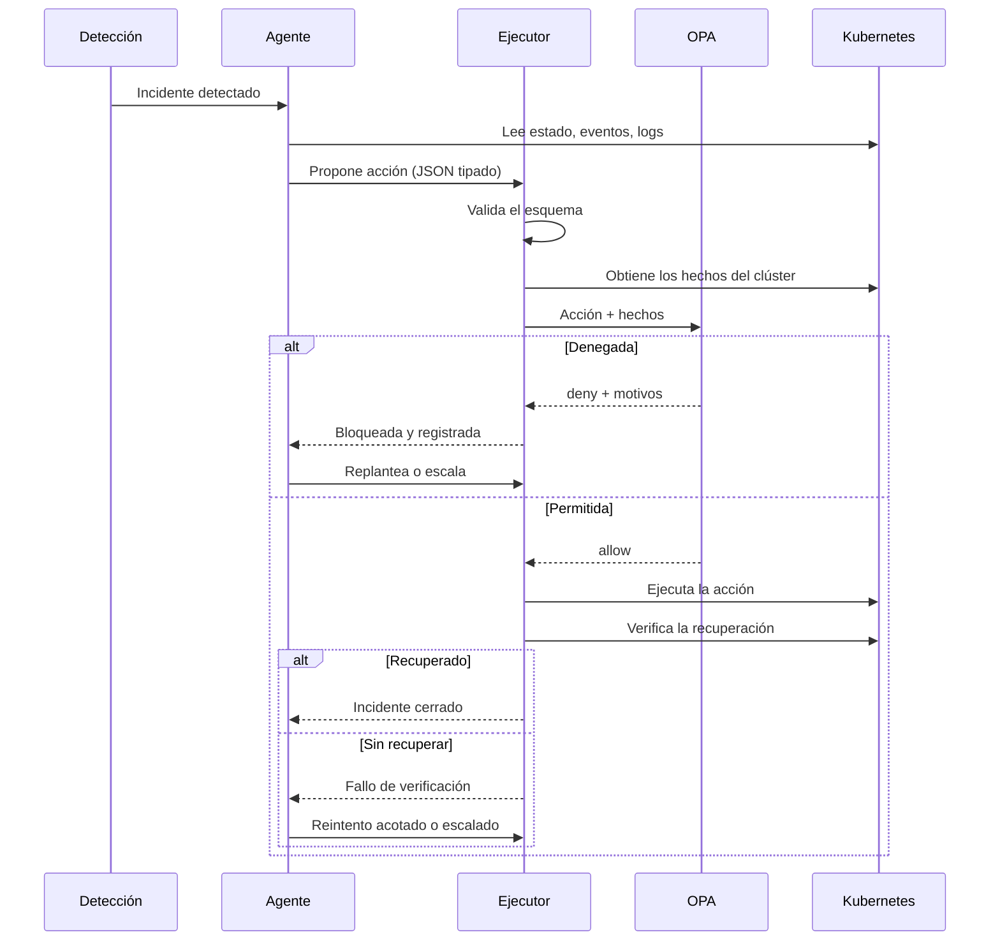

# Arquitectura

## Componentes



La separación clave es entre dos planos:

- **Plano de decisión.** Se considera no fiable, porque su entrada incluye contenido que un atacante puede influir (logs, por ejemplo) y su razonamiento puede fallar. Solo tiene credenciales de lectura.
- **Plano de control.** Es código determinista, sin LLM. Es el único con permisos de escritura.

Esto convierte a OPA en un verdadero *reference monitor*: no se apoya en que el agente decida consultarlo, porque el agente no dispone de credenciales para actuar por otra vía.

## Flujo de un incidente



## Frontera de seguridad

| Mecanismo | Qué garantiza |
|-----------|---------------|
| Credenciales separadas | El agente solo lee; el ejecutor es el único que escribe |
| RBAC del ejecutor | Limitado al namespace `otel-demo` y a los Deployments permitidos, sin Secrets |
| Operaciones fijas | El ejecutor implementa cada acción del catálogo; nunca ejecuta texto generado por el modelo |
| Validación de esquema | Una salida malformada del modelo se rechaza antes de llegar a OPA |
| Hechos obtenidos por el ejecutor | La política evalúa datos leídos del clúster, no lo que el modelo afirma |
| Denegación por defecto | Si OPA no responde o no hay regla, la acción no se ejecuta (*fail-closed*) |
| Límite de frecuencia | Corta los bucles de remediación |
| Registro de auditoría | Cada propuesta y decisión queda registrada, también las bloqueadas |

RBAC y OPA son capas complementarias: RBAC no distingue, por ejemplo, un cambio de memoria razonable de uno excesivo; OPA sí. Y si la política tuviera un error, RBAC sigue acotando el daño posible.

### Alternativa considerada: control de admisión

OPA Gatekeeper impone políticas en la propia API de Kubernetes, por lo que no depende de ningún componente propio. Se mantiene el ejecutor porque aplica con más facilidad límites de frecuencia y condiciones ligadas al incidente, y porque cada acción sigue siendo una operación fija. El control de admisión queda como posible capa adicional, no como sustituto.

## Contrato con OPA

Entrada que el ejecutor envía a la política:

```json
{
  "action": {
    "type": "rollout_undo",
    "namespace": "otel-demo",
    "target": "product-catalog",
    "params": {}
  },
  "facts": {
    "deployment_exists": true,
    "previous_revision": 4,
    "pods_waiting_reason": ["CrashLoopBackOff"],
    "actions_last_hour_on_target": 0
  }
}
```

`action` procede de la propuesta del agente; `facts` lo completa el ejecutor. Respuesta:

```json
{ "allow": false, "deny_reasons": ["target no permitido"] }
```

## Prompt injection indirecta

Los logs y eventos son datos que pueden contener instrucciones maliciosas. Se asume que algún intento puede engañar al modelo, y la defensa no depende de evitarlo: aunque el agente proponga una acción dañina, tiene que superar la validación, OPA y RBAC. Marcar el contenido no fiable en el prompt reduce la probabilidad de engaño, pero no se cuenta como control de seguridad.

Esta defensa limita **qué** puede hacerse, no si la decisión es acertada: un modelo manipulado aún podría proponer una acción permitida pero innecesaria, como reiniciar un servicio sano. La exigencia de hechos que justifiquen la acción y el límite de frecuencia reducen ese margen, y la evaluación debe medirlo.
