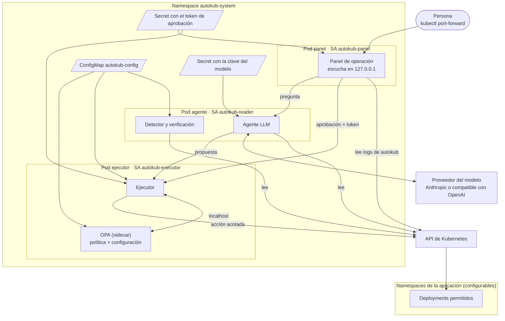

# Despliegue en un clúster real

> **Estado:** publicado en la versión 0.1.0 ([ADR 0006](adr/0006-producto-instalable.md)). El panel de operación y el modo `approve` ([ADR 0009](adr/0009-panel-de-operacion.md)) llegan con la 0.2.0.

Este documento describe cómo se instala y funciona autokub en cualquier clúster de Kubernetes. En el laboratorio, los mismos componentes corren como procesos locales contra la tienda de demostración, tal como describe [arquitectura.md](arquitectura.md).

La arquitectura no cambia: un agente que solo lee y propone, un ejecutor determinista que es el único que escribe, OPA autorizando cada acción y verificación posterior. Lo que cambia es dónde corre cada pieza, de dónde saca su configuración y con qué permisos.

## Qué se instala



| Componente | Dónde corre | Identidad | Qué puede hacer |
|---|---|---|---|
| Detector + agente | Pod `autokub-agent` | ServiceAccount `autokub-reader` | Leer pods, logs, eventos, Deployments y ReplicaSets de los namespaces configurados. Nada más |
| Ejecutor | Pod `autokub-executor` | ServiceAccount `autokub-executor` | Leer lo necesario para obtener los hechos y, solo en modo ejecución, aplicar acciones sobre los Deployments permitidos |
| OPA | Sidecar del ejecutor | La del ejecutor, sin usarla | Evaluar la política. Solo escucha en `localhost`, así que nadie más que el ejecutor puede consultarlo |
| Panel | Pod `autokub-panel`, opcional (activado por defecto) | ServiceAccount `autokub-panel` | Leer los logs de los pods de autokub en su propio namespace. Reenviar al ejecutor decisiones sobre acciones pendientes y al agente preguntas de solo lectura. Ningún permiso sobre la aplicación |

### Por qué el agente y el ejecutor van en pods distintos

En Kubernetes la identidad es del pod: todos sus contenedores comparten el token de la misma ServiceAccount. Si el agente compartiera pod con el ejecutor, tendría a mano credenciales de escritura y la separación entre quien propone y quien ejecuta dejaría de existir. Por eso son dos pods con dos ServiceAccounts, y la única vía del agente para actuar es enviar una propuesta al ejecutor.

OPA, en cambio, va dentro del pod del ejecutor: así solo él puede consultarlo, no hay que exponerlo en la red y, si OPA no arranca, el ejecutor deniega todo (*fail-closed*), como hoy.

## Configuración

Toda la información que antes estaba fijada para la demo vive en un único fichero. Quien instala escribe sus valores en YAML (`autokub.yaml`, los values del chart) y el chart los convierte en un ConfigMap con el JSON que leen los componentes. En el laboratorio, ese JSON es `config/lab.json`.

```yaml
# autokub.yaml
mode: propose            # propose (por defecto) | approve | execute

approval:
  timeoutSeconds: 900    # modo approve: tiempo para decidir antes de avisar a una persona

panel:
  enabled: true
  chat: true             # chat de solo lectura con el agente (solo con el agente LLM)
  host: 127.0.0.1        # 0.0.0.0 solo detrás de un proxy que autentique (y su nombre en allowedHosts)

namespaces:
  tienda:
    targets: [cart, checkout, payment]   # Deployments sobre los que se puede actuar
  pagos:
    targets: [cobros]

limits:
  max_actions_per_hour: 3                 # por Deployment
  max_memory_bytes: 536870912             # techo de set_memory_limit (512 Mi)

detection:
  min_restarts: 2
  stable_seconds: 30
  verify_timeout_seconds: 120
  max_attempts: 2

model:
  provider: openai                        # anthropic | openai (cualquier API compatible: LiteLLM, Ollama, vLLM…)
  name: <modelo>
  base_url: http://litellm:4000/v1        # solo con provider: openai
  api_key_secret: autokub-llm             # Secret con la clave, en autokub-system (opcional en modelos locales)
```

De esta misma configuración salen tres cosas, para que no haya copias que mantener a mano:

- **Lo que vigila el detector** y lo que el agente cuenta en su prompt (namespaces y servicios).
- **Los datos de la política.** OPA recibe la configuración como `data`, y las reglas Rego dejan de tener listas fijas: `allowed_targets` y `namespace` pasan a leerse de `data.autokub`.
- **El RBAC.** Se genera un Role y un RoleBinding por cuenta y por cada namespace de la lista, con `resourceNames` limitados a sus `targets`. En el laboratorio lo hace `infra/rbac.py`; en el chart, sus plantillas.

Así, RBAC y OPA siguen siendo dos barreras independientes, pero construidas desde la misma fuente: si la política tuviera un error, RBAC sigue impidiendo actuar fuera de la lista.

## Modos de funcionamiento

| | `propose` (por defecto) | `approve` | `execute` |
|---|---|---|---|
| Detecta y diagnostica | Sí | Sí | Sí |
| Propone una acción y consulta a OPA | Sí | Sí | Sí |
| Aplica la acción | **No**: registra `action_would_execute` con la decisión de OPA | Si una persona la aprueba en el panel y OPA la vuelve a permitir | Sí, si OPA la permite |
| Verificación y reintento | No aplica | Sí, tras aprobar | Sí |
| Permiso `patch` sobre Deployments | **No se concede** | Solo sobre los `targets` | Solo sobre los `targets` |

El modo propuesta existe porque nadie debería dejar que un agente desconocido modifique su clúster el primer día. Primero se observa qué habría hecho y si OPA lo habría permitido; cuando esas propuestas son fiables, se pasa a `execute`.

En modo propuesta el chart **no concede permisos de escritura**: aunque el ejecutor tuviera un fallo, no podría modificar nada. Pasar a `approve` o `execute` es un cambio explícito de configuración (`helm upgrade --set mode=approve`) que añade el permiso `patch`.

`approve` es el paso intermedio: autokub actúa, pero cada acción la decide una persona en el panel. En modo aprobación, la acción que OPA permite queda pendiente en la memoria del ejecutor. Si caduca o el ejecutor se reinicia, no se aplica y se avisa a una persona.

## Instalación

> Se publican con la release 0.1. Mientras tanto, `make try` instala el chart desde el repositorio en un clúster local.

```bash
# 1. Clave del modelo, solo para el pod del agente
kubectl create namespace autokub-system
kubectl -n autokub-system create secret generic autokub-llm --from-literal=api-key=<clave>

# 2. Instalación en modo propuesta
helm install autokub oci://ghcr.io/marcosperezcantero/charts/autokub \
  --namespace autokub-system -f autokub.yaml

# 3. Abrir el panel de operación en http://localhost:8091
kubectl -n autokub-system port-forward deploy/autokub-panel 8091

# Desinstalar: elimina también todo el RBAC creado en los namespaces de la aplicación
helm uninstall autokub -n autokub-system
```

Requisitos: Kubernetes con la API `apps/v1`, permisos para crear Roles en los namespaces de la aplicación y acceso de salida desde el clúster al proveedor del modelo. No necesita Prometheus ni ningún otro componente de observabilidad: en la versión 0.1 la detección lee el estado de los pods.

## Seguridad en el clúster

Se mantienen todas las garantías de [arquitectura.md](arquitectura.md#frontera-de-seguridad), y el despliegue añade estas:

| Mecanismo | Qué garantiza |
|---|---|
| RBAC por namespace, sin ClusterRoles | autokub no tiene permisos fuera de los namespaces configurados |
| Sin acceso a Secrets | Ni el agente ni el ejecutor pueden leer Secrets por la API. La clave del modelo llega al agente montada por el kubelet, y el ejecutor nunca la ve |
| Escritura solo en modo `execute` | En modo propuesta el sistema no puede modificar el clúster |
| OPA como sidecar | La política no es accesible desde la red |
| NetworkPolicy | El ejecutor solo acepta tráfico del pod del agente (comprobado: un pod de otro namespace recibe conexión rechazada). Restringir también la salida depende de la red de cada clúster y queda a quien instala |
| `enableServiceLinks: false` | Kubernetes no inyecta variables de los Services, que llegaron a pisar la configuración del ejecutor |
| Una réplica de cada componente | Dos detectores propondrían dos veces la misma acción. El límite de frecuencia lo cortaría, pero es mejor no provocarlo |
| Contenedores sin root, sistema de ficheros de solo lectura | Reduce lo que puede hacer un proceso comprometido |
| Token de aprobación solo en el ejecutor y el panel | El agente puede llegar al ejecutor, pero no puede aprobar sus propias propuestas |
| Panel solo en `127.0.0.1`, sin Service | Solo se llega con `kubectl port-forward`: quién puede operar lo decide el RBAC (`pods/portforward` en `autokub-system`). El panel rechaza otros orígenes y nombres de host ajenos |
| Chat solo desde el panel | Una NetworkPolicy impide que otros pods consulten al modelo |

## Datos que salen del clúster

El agente envía al proveedor del modelo lo que lee para diagnosticar: estado de los pods, eventos, diferencias entre revisiones y las últimas líneas de log. Los valores de variables con nombres sensibles (`PASSWORD`, `TOKEN`, `KEY`…) y las credenciales dentro de URLs se censuran, pero un log puede contener otros datos. Si eso no es aceptable, usa un modelo local con `provider: openai` (Ollama, vLLM). En ese caso, `base_url` debe ser `https://` o una dirección interna del clúster: con `http://` hacia fuera, la clave viajaría sin cifrar.

## Trazabilidad

En el laboratorio, los tres procesos escriben en el mismo fichero de eventos. En el clúster no comparten disco, así que cada componente escribe sus eventos JSON, con el mismo formato y el mismo `incident_id`, en su salida estándar. Se consultan con `kubectl logs` y los recoge cualquier sistema de logs que tenga el clúster (Loki, Elasticsearch, CloudWatch…).

`make try-events` los muestra en directo, una línea por paso, y el panel de operación los reconstruye leyendo los logs de los pods del agente y del ejecutor. Por eso el historial del panel alcanza lo que conserven esos logs: si un pod se reinicia, sus eventos anteriores desaparecen del panel, que marca esos incidentes como «historial incompleto». Para conservarlos, basta el sistema de logs del clúster.

## GitOps

Si la aplicación se gestiona con Argo CD o Flux con autocorrección, un rollback hecho directamente en la API se revierte en cuanto la herramienta vuelve a sincronizar. En modo propuesta no hay conflicto, porque no se modifica nada. Para `approve` y `execute` en clústeres con GitOps, el [ADR 0003](adr/0003-remediacion-con-gitops.md) decide una remediación mixta: rollback por la API y una PR al repositorio GitOps que una persona fusiona (con autocorrección, solo la PR). Está pendiente de implementar; mientras tanto, en esos clústeres conviene usar el modo propuesta o `approve`.

## Diferencias con el laboratorio

| | Laboratorio (hoy) | Clúster real (0.1) |
|---|---|---|
| Dónde corre | Procesos en la máquina local | Pods en `autokub-system` |
| Credenciales | Kubeconfigs con tokens de 24 h en `.local/` | Tokens de ServiceAccount que Kubernetes renueva solo |
| Aplicación | `otel-demo`, fijada en el código | Namespaces y servicios de `autokub.yaml` |
| Política | Listas fijas en Rego | Reglas genéricas + configuración como `data` |
| Modo | Siempre ejecuta | Propuesta por defecto |
| Modelo | API de Anthropic o compatible con OpenAI | Igual: el proveedor se elige en la configuración |
| Eventos | Un fichero compartido | Salida estándar de cada pod |
| Instalación | Scripts y `make` | `helm install` |

## Historial de acciones

El límite de frecuencia necesita saber cuántas acciones se han aplicado sobre cada Deployment en la última hora. Ese historial no puede vivir en la memoria ni en un fichero del pod del ejecutor, porque se perdería al reiniciarse y el límite volvería a cero. Se guarda en el propio Deployment, en la anotación `autokub.io/action-history`, como una lista de marcas de tiempo:

- El ejecutor **registra la acción antes de aplicarla**. Si no puede escribir la anotación, no actúa.
- `kubectl rollout undo` copia en el Deployment las anotaciones de la revisión antigua y borra las demás, así que tras un rollback el ejecutor vuelve a escribir el historial.
- Si la anotación no se puede interpretar, el hecho se envía a OPA como desconocido y la política deniega la acción.

Escribir la anotación usa el mismo permiso `patch` que las acciones, así que no amplía lo que puede hacer el ejecutor.

## Decisiones abiertas

- **Remediación con GitOps**: decidida en el [ADR 0003](adr/0003-remediacion-con-gitops.md), pendiente de implementar.
