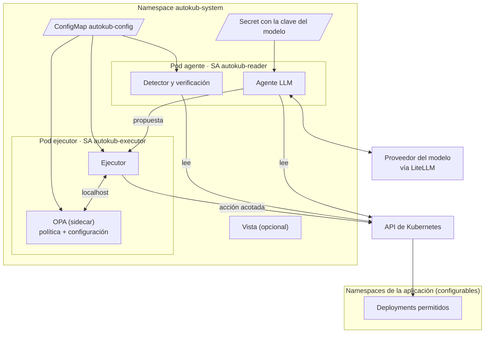

# Despliegue en un clúster real

> **Estado: en construcción para la versión 0.1** ([ADR 0006](adr/0006-producto-instalable.md)). Hechos: configuración en un fichero, historial en el Deployment, modo propuesta y modelo intercambiable ([ADR 0007](adr/0007-interfaz-con-el-modelo.md)). También el chart de Helm y las imágenes, probados en k3d. Pendiente: publicar la release 0.1.
>
> **Diseño objetivo de la versión 0.1** ([ADR 0006](adr/0006-producto-instalable.md)). Aún no está implementado. Hoy el sistema funciona como laboratorio: los componentes corren como procesos en una máquina local contra la tienda de demostración, tal como describe [arquitectura.md](arquitectura.md). Este documento define cómo se instala y funciona en cualquier clúster de Kubernetes, y guía los pasos de la versión 0.1.

La arquitectura no cambia: un agente que solo lee y propone, un ejecutor determinista que es el único que escribe, OPA autorizando cada acción y verificación posterior. Lo que cambia es dónde corre cada pieza, de dónde saca su configuración y con qué permisos.

## Qué se instala



| Componente | Dónde corre | Identidad | Qué puede hacer |
|---|---|---|---|
| Detector + agente | Pod `autokub-agent` | ServiceAccount `autokub-reader` | Leer pods, logs, eventos, Deployments y ReplicaSets de los namespaces configurados. Nada más |
| Ejecutor | Pod `autokub-executor` | ServiceAccount `autokub-executor` | Leer lo necesario para obtener los hechos y, solo en modo ejecución, aplicar acciones sobre los Deployments permitidos |
| OPA | Sidecar del ejecutor | La del ejecutor, sin usarla | Evaluar la política. Solo escucha en `localhost`, así que nadie más que el ejecutor puede consultarlo |
| Vista | Pod `autokub-viewer`, opcional | Sin permisos sobre la aplicación | Mostrar los eventos. Sin forma de actuar |

### Por qué el agente y el ejecutor van en pods distintos

En Kubernetes la identidad es del pod: todos sus contenedores comparten el token de la misma ServiceAccount. Si el agente compartiera pod con el ejecutor, tendría a mano credenciales de escritura y la separación entre quien propone y quien ejecuta dejaría de existir. Por eso son dos pods con dos ServiceAccounts, y la única vía del agente para actuar es enviar una propuesta al ejecutor.

OPA, en cambio, va dentro del pod del ejecutor: así solo él puede consultarlo, no hay que exponerlo en la red y, si OPA no arranca, el ejecutor deniega todo (*fail-closed*), como hoy.

## Configuración

Toda la información que antes estaba fijada para la demo vive en un único fichero. Quien instala escribe sus valores en YAML (`autokub.yaml`, los values del chart) y el chart los convierte en un ConfigMap con el JSON que leen los componentes. En el laboratorio, ese JSON es `config/lab.json`.

```yaml
# autokub.yaml
mode: propose            # propose (por defecto) | execute

namespaces:
  tienda:
    targets: [cart, checkout, payment]   # Deployments sobre los que se puede actuar
  pagos:
    targets: [cobros]

limits:
  max_actions_per_hour: 3                 # por Deployment
  max_memory_bytes: 536870912             # techo de set_memory_limit (512 Mi)

detection:
  min_restarts: 2
  stable_seconds: 30
  verify_timeout_seconds: 120
  max_attempts: 2

model:
  provider: openai                        # anthropic | openai (cualquier API compatible: LiteLLM, Ollama, vLLM…)
  name: <modelo>
  base_url: http://litellm:4000/v1        # solo con provider: openai
  api_key_secret: autokub-llm             # Secret con la clave, en autokub-system (opcional en modelos locales)
```

De esta misma configuración salen tres cosas, para que no haya copias que mantener a mano:

- **Lo que vigila el detector** y lo que el agente cuenta en su prompt (namespaces y servicios).
- **Los datos de la política.** OPA recibe la configuración como `data`, y las reglas Rego dejan de tener listas fijas: `allowed_targets` y `namespace` pasan a leerse de `data.autokub`.
- **El RBAC.** Se genera un Role y un RoleBinding por cuenta y por cada namespace de la lista, con `resourceNames` limitados a sus `targets`. En el laboratorio lo hace `infra/rbac.py`; en el chart, sus plantillas.

Así, RBAC y OPA siguen siendo dos barreras independientes, pero construidas desde la misma fuente: si la política tuviera un error, RBAC sigue impidiendo actuar fuera de la lista.

## Modos de funcionamiento

| | `propose` (por defecto) | `execute` |
|---|---|---|
| Detecta y diagnostica | Sí | Sí |
| Propone una acción y consulta a OPA | Sí | Sí |
| Aplica la acción | **No**: registra `action_would_execute` con la decisión de OPA | Sí, si OPA la permite |
| Verificación y reintento | No aplica | Sí, como hoy |
| Permiso `patch` sobre Deployments | **No se concede** | Solo sobre los `targets` |

El modo propuesta existe porque nadie debería dejar que un agente desconocido modifique su clúster el primer día. Primero se observa qué habría hecho y si OPA lo habría permitido; cuando esas propuestas son fiables, se pasa a `execute`.

En modo propuesta el chart **no concede permisos de escritura**: aunque el ejecutor tuviera un fallo, no podría modificar nada. Pasar a `execute` es un cambio explícito de configuración (`helm upgrade --set mode=execute`) que añade el permiso `patch`.

## Instalación

> Se publican con la release 0.1. Mientras tanto, `make try` instala el chart desde el repositorio en un clúster local.

```bash
# 1. Clave del modelo, solo para el pod del agente
kubectl create namespace autokub-system
kubectl -n autokub-system create secret generic autokub-llm --from-literal=api-key=<clave>

# 2. Instalación en modo propuesta
helm install autokub oci://ghcr.io/marcosperezcantero/charts/autokub \
  --namespace autokub-system -f autokub.yaml

# 3. Ver qué propone
kubectl -n autokub-system logs deploy/autokub-executor -f

# Desinstalar: elimina también todo el RBAC creado en los namespaces de la aplicación
helm uninstall autokub -n autokub-system
```

Requisitos: Kubernetes con la API `apps/v1`, permisos para crear Roles en los namespaces de la aplicación y acceso de salida desde el clúster al proveedor del modelo. No necesita Prometheus ni ningún otro componente de observabilidad: en la versión 0.1 la detección lee el estado de los pods.

## Seguridad en el clúster

Se mantienen todas las garantías de [arquitectura.md](arquitectura.md#frontera-de-seguridad), y el despliegue añade estas:

| Mecanismo | Qué garantiza |
|---|---|
| RBAC por namespace, sin ClusterRoles | autokub no tiene permisos fuera de los namespaces configurados |
| Sin acceso a Secrets | Ni el agente ni el ejecutor pueden leer Secrets por la API. La clave del modelo llega al agente montada por el kubelet, y el ejecutor nunca la ve |
| Escritura solo en modo `execute` | En modo propuesta el sistema no puede modificar el clúster |
| OPA como sidecar | La política no es accesible desde la red |
| NetworkPolicy | El ejecutor solo acepta tráfico del pod del agente (comprobado: un pod de otro namespace recibe conexión rechazada). Restringir también la salida depende de la red de cada clúster y queda a quien instala |
| `enableServiceLinks: false` | Kubernetes no inyecta variables de los Services, que llegaron a pisar la configuración del ejecutor |
| Una réplica de cada componente | Dos detectores propondrían dos veces la misma acción. El límite de frecuencia lo cortaría, pero es mejor no provocarlo |
| Contenedores sin root, sistema de ficheros de solo lectura | Reduce lo que puede hacer un proceso comprometido |

## Trazabilidad

En el laboratorio, los tres procesos escriben en el mismo fichero de eventos. En el clúster no comparten disco, así que cada componente escribe sus eventos JSON, con el mismo formato y el mismo `incident_id`, en su salida estándar. Se consultan con `kubectl logs` y los recoge cualquier sistema de logs que tenga el clúster (Loki, Elasticsearch, CloudWatch…).

`make try-events` los muestra en directo, una línea por paso. La vista web sigue siendo una herramienta del laboratorio y no se instala con el chart en la versión 0.1.

## GitOps

Si la aplicación se gestiona con Argo CD o Flux con autocorrección, un rollback hecho directamente en la API se revierte en cuanto la herramienta vuelve a sincronizar. En modo propuesta no hay conflicto, porque no se modifica nada. Para el modo ejecución en clústeres con GitOps, la forma de remediar (proponer un cambio en el repositorio, pausar la sincronización o actuar por la API) es la decisión pendiente del ADR 0003.

## Diferencias con el laboratorio

| | Laboratorio (hoy) | Clúster real (0.1) |
|---|---|---|
| Dónde corre | Procesos en la máquina local | Pods en `autokub-system` |
| Credenciales | Kubeconfigs con tokens de 24 h en `.local/` | Tokens de ServiceAccount que Kubernetes renueva solo |
| Aplicación | `otel-demo`, fijada en el código | Namespaces y servicios de `autokub.yaml` |
| Política | Listas fijas en Rego | Reglas genéricas + configuración como `data` |
| Modo | Siempre ejecuta | Propuesta por defecto |
| Modelo | API de Anthropic o compatible con OpenAI | Igual: el proveedor se elige en la configuración |
| Eventos | Un fichero compartido | Salida estándar de cada pod |
| Instalación | Scripts y `make` | `helm install` |

## Historial de acciones

El límite de frecuencia necesita saber cuántas acciones se han aplicado sobre cada Deployment en la última hora. Ese historial no puede vivir en la memoria ni en un fichero del pod del ejecutor, porque se perdería al reiniciarse y el límite volvería a cero. Se guarda en el propio Deployment, en la anotación `autokub.io/action-history`, como una lista de marcas de tiempo:

- El ejecutor **registra la acción antes de aplicarla**. Si no puede escribir la anotación, no actúa.
- `kubectl rollout undo` copia en el Deployment las anotaciones de la revisión antigua y borra las demás, así que tras un rollback el ejecutor vuelve a escribir el historial.
- Si la anotación no se puede interpretar, el hecho se envía a OPA como desconocido y la política deniega la acción.

Escribir la anotación usa el mismo permiso `patch` que las acciones, así que no amplía lo que puede hacer el ejecutor.

## Decisiones abiertas

- **La vista en el clúster.** Leer logs de pods es sencillo pero depende de su retención; alternativa: que la vista no se instale y los eventos se consulten en el sistema de logs del clúster.
- **Remediación con GitOps**: ADR 0003.
